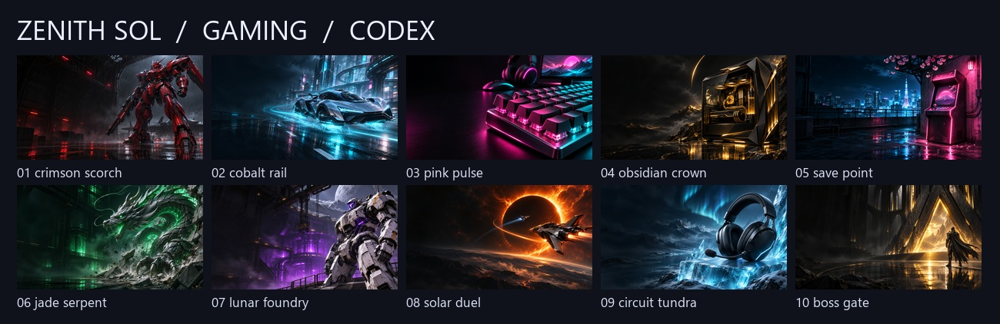

# ゼニットソル 公開作品

**[作品ページで試す](https://zenith-sol-home.adeptcart16.chatgpt.site/works/) · [配布ZIPを保存](https://github.com/wuhuangj-wq/zenith-sol-showcase/releases/tag/v1.0.0)**

完成した配布物と、機能を限定したブラウザ体験版の案内です。試作中の会話AIやWindows製品は含めていません。

| 公開物 | できること | 使う |
|---|---|---|
| 現場写真台帳 | 写真30枚までを整理し、ブラウザ印刷でPDF保存・一覧CSV出力 | [開く](https://zenith-sol-home.adeptcart16.chatgpt.site/tools/photo-ledger/) · [ZIP](downloads/photo-ledger.zip) |
| トジマリ ブラウザ体験版 | 見本の辞書・決まった形式を伏せ字にし、答えの札を元に戻す | [開く](https://zenith-sol-home.adeptcart16.chatgpt.site/tools/tojimari/) |
| ゲーミング壁紙20枚 | PC用1920×1080、JPEG | [一覧・ZIP](https://zenith-sol-home.adeptcart16.chatgpt.site/works/#wallpapers) |
| ナディー壁紙2枚 | スマホ用853×1844、PC用1672×941、PNG | [ZIP](downloads/nadi-wallpapers.zip) |

現場写真台帳はZIPを展開し、`写真台帳.html`をWindowsのChromeまたはEdgeで開きます。「架空サンプルを開く」で試せます。写真とメモは閉じると消えるので、PDF・CSVを保存してください。指定の提出様式への適合は確認が必要です。CSVには写真本体は入りません。

トジマリの公開範囲はブラウザ体験版です。自分の辞書登録・人名の自動抽出・AI会話は含みません。見落としはあるため、外のAIに送る前に必ず目で確認してください。Windows製品のコードとモデルはこのリポジトリに含めません。

## 利用条件

写真台帳のコードは[MIT](LICENSE)。画像は個人の端末の壁紙として無料利用できます。再配布・画像自体の販売はできません。詳しくは[利用条件](USAGE.md)をお読みください。画像作品には生成AIを使っています。Codex・Claude Codeはゲーミング壁紙を各10案企画し、画像生成で制作しました。

## 検証と不具合

[検証記録](VERIFICATION.md) · [ファイルサイズ・SHA-256](downloads/manifest.json)

不具合は[Issues](https://github.com/wuhuangj-wq/zenith-sol-showcase/issues)へ。端末・ブラウザ・手順だけを添えてください。個人情報や機密資料を含めないでください。全端末での動作を保証するものではありません。

## 開発と再テストの記事

[トジマリのルール処理・制限・再テストの記録](articles/tojimari-browser-redaction.md)。Zenn連携用の原稿です。Zenn上ではまだ公開していません。
